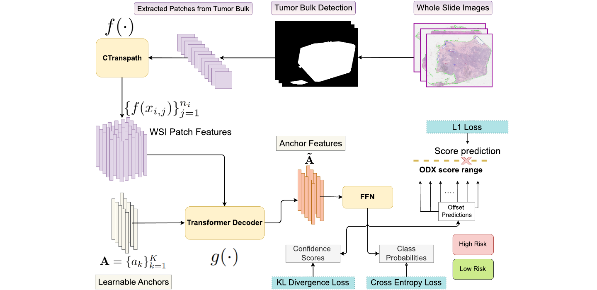
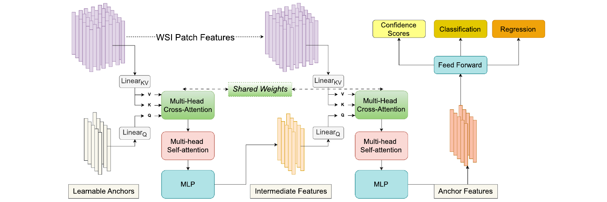
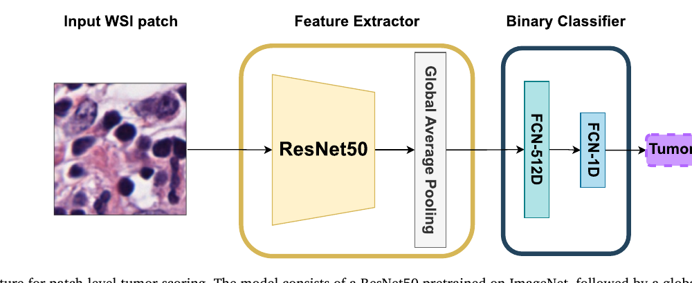
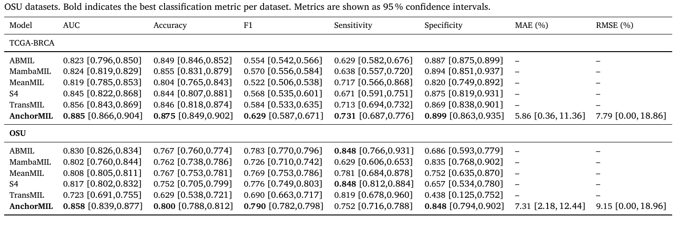
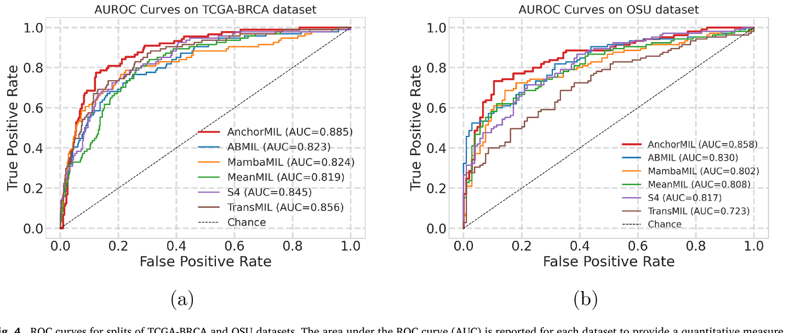
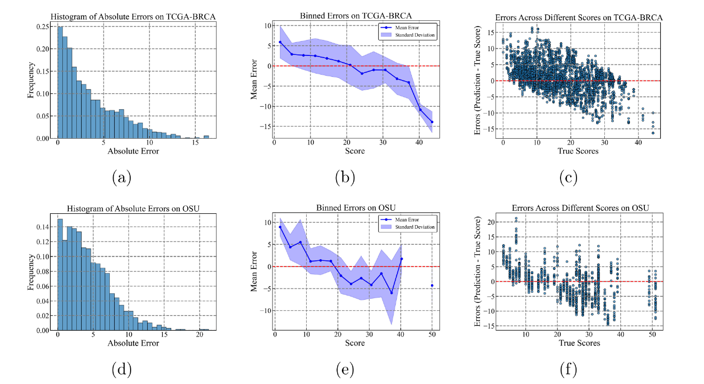
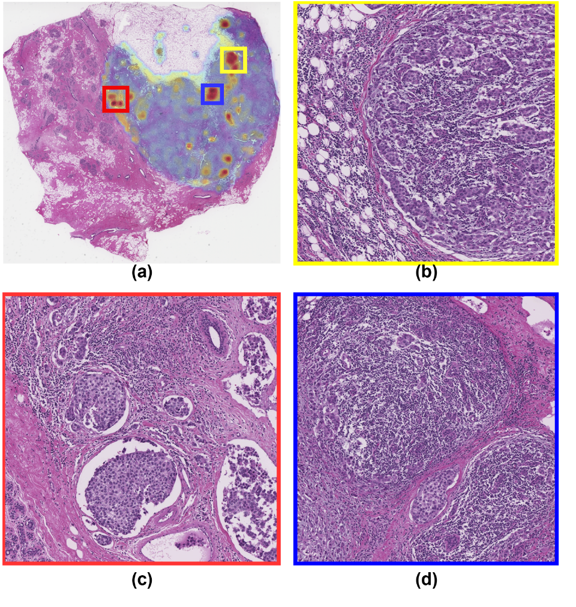
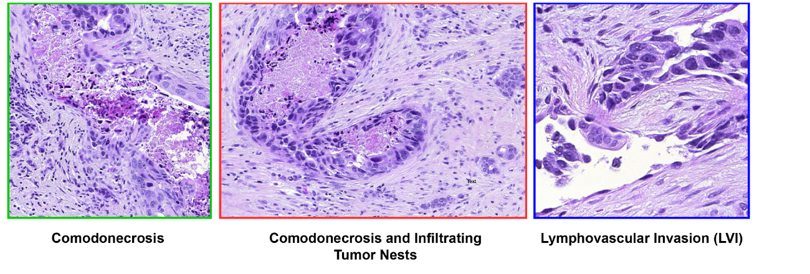

# AnchorMIL

PyTorch implementation of **AnchorMIL** from *H&E to Oncotype DX: Predicting recurrence risk in HR+/HER2- breast cancer* (Koyun et al., Expert Systems With Applications 303, 2026, 130469).

AnchorMIL predicts the continuous Oncotype DX recurrence score (ODX) and a high/low-risk label (ODX > 25) from H&E whole-slide images. K learnable anchors cross-attend to patch features. Each refined anchor outputs a confidence `c_k`, a regression offset (`r_k = s_k + h_r(a_k)`, with `s_k` evenly spaced over 0-100) and a risk logit `p_k`. The prediction is the confidence-weighted sum over anchors. Loss: `beta * L1 + KL(confidence) + BCE`.



Pipeline: tumor-bulk detection, CTransPath patch features, anchor-based transformer decoder, then confidence-weighted regression and classification.





## Layout
- `anchormil/model.py` - transformer decoder (shared cross-attention, self-attention, MLP) and anchored heads
- `anchormil/losses.py` - regression, confidence-matching and BCE losses
- `anchormil/tumor_scorer.py` - ResNet50 tumor scorer and Tumor Score patch selection (Eq. 1)
- `anchormil/data.py`, `anchormil/metrics.py`, `train.py`

## Usage
Extract patch features first (paper: tumor-bulk patches, 896x896 at 20x, CTransPath, 768-d) and save one `<slide_id>.pt` tensor of shape `(n_patches, 768)` per slide. Prepare a CSV with columns `slide_id,patient_id,odx,split` (`train`/`val`/`test`; keep a patient's slides in one split).

```bash
pip install -r requirements.txt
python train.py --csv data.csv --feat_dir features/ --out_dir runs/exp1
pytest tests
```

Defaults follow Table 2 (128 anchors, 12 heads, 2 blocks, AdamW lr 5e-4, wd 1e-3, cosine to 1e-5, 5 warmup epochs, 20 epochs, batch 32, beta 0.7).

## Results (reported in the paper)

Performance on TCGA-BRCA and the OSU cohort (95% CIs):



ROC curves:



Regression error analysis for the continuous ODX prediction:



## Interpretability

Attention heatmap on a high-risk slide, with the highest-attention regions zoomed in:



High-risk patterns the model focuses on (comedonecrosis, lymphovascular invasion):



Figures and table are reproduced from the paper (open access, CC BY 4.0). They show the authors' reported results, not outputs of this repository's code.

## Notes
- WSI tiling, tumor-scorer training and CTransPath weights are not included; obtain CTransPath from its authors.
- The confidence KL term is implemented as written in the paper, `KL(c || c_target)`.
- Padded patches are masked in cross-attention. The OSU cohort is not distributed.

## Citation
Koyun O.C. et al., *H&E to Oncotype DX: Predicting recurrence risk in HR+/HER2- breast cancer*, Expert Systems With Applications 303 (2026) 130469. https://doi.org/10.1016/j.eswa.2025.130469
